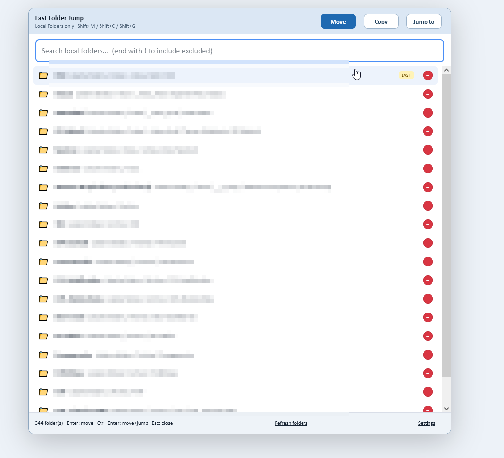
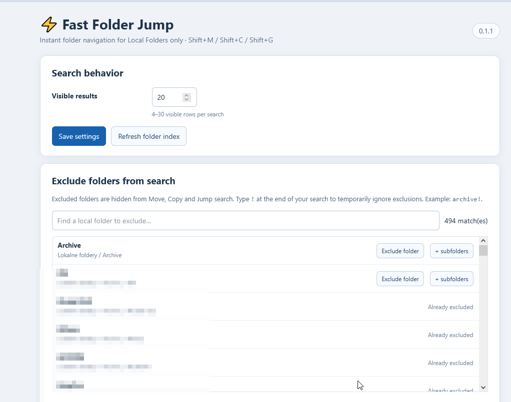

# Fast Folder Jump

**Fast, keyboard-first Move / Copy / Jump-to-folder for Thunderbird Local Folders.**

Fast Folder Jump is an independent add-on inspired by the workflow of [Nostalgy](https://addons.thunderbird.net/), Nostalgy++ and [Quick Folder Move](https://github.com/kewisch/quickmove-extension). It is **not a source-code fork** of those projects.

Instead of loading a new search window or scanning the folder tree every time you use a shortcut, the extension keeps a folder index cached and mounts its search panel inside Thunderbird's existing mail view. This is designed to make opening the search feel immediate, even with many nested folders.

## Features

- **Shift+M** — move selected messages.
- **Shift+C** — copy selected messages.
- **Shift+G** — jump to a folder.
- Choose **Move / Copy / Jump to** in the panel header.
- Search folder names and complete paths, including deeply nested folders.
- Recently used destinations are prioritized; the last destination is offered first.
- Exclude a folder with the small red **−** beside a result, or exclude entire folder branches in Settings.
- Add **`!` at the end** of a query, e.g. `archive!`, to temporarily include excluded folders. A lone `!` lists all indexed folders, including exclusions.
- Configure 4–30 visible search results, then navigate with arrow keys and Enter.
- Uses a fully opaque, easy-to-read interface and stores its index locally.

## Compatibility and limitations

- **Local Folders only** (`account.type === "none"`); IMAP and other remote account folders are intentionally not indexed.
- The publishing build declares Thunderbird **140.0 through 153.*** compatibility. The full range has **not** been tested in a live Thunderbird installation.
- Uses a bundled **Thunderbird Experiment API** to mount the panel and capture Shift-only shortcuts. Thunderbird may show a broad privilege warning.
- **Shift+C** overlaps Thunderbird's native “Mark all as read” shortcut and may conflict with Nostalgy++. Disable conflicting shortcuts while testing.

## Installation

1. Open this repository's **Releases** page and download `fast-folder-jump-v0.1.5.xpi`.
2. In Thunderbird, choose **Add-ons and Themes → Install Add-on From File**.
3. Install the XPI, accept required permissions, and select a disposable test message.
4. Try Shift+G (navigate), followed by Shift+C and Shift+M on test messages.

The GitHub/ATN build uses extension ID `gawkla.fast-folder-jump@addons.thunderbird.net`. It is **not** an in-place upgrade of the older local test build with ID `fast-folder-jump@local`; those builds use separate extension storage. Back up any exclusions/recent destinations before switching.


## Screenshots

### Instant folder search

Fast, keyboard-driven Move, Copy and Jump-to-folder
with one-click folder exclusions.



### Settings and folder exclusions

Configure the number of visible results and exclude
individual folders or entire folder trees.




## Build and tests

No compilation or third-party JavaScript dependencies are required. The add-on's `manifest.json` and source files live in the repository root.

```bash
node tests/smoke.cjs
node tests/exclude.cjs
```

Build a clean XPI with `python tools/build_xpi.py`. The builder includes **only runtime files**, with `manifest.json` at the root; it excludes tests and GitHub documents. The official release attachment is the already packaged, unmodified publishing build.

## Privacy and support

Folder indexing and settings are local; no analytics, cloud service, or automatic network requests. Read [Privacy Policy](PRIVACY.md). All features are free. Optional support: [Buy me a coffee](https://ko-fi.com/gawkla).

## Credits and license

Inspired by the workflows of Nostalgy (Alain Frisch), Nostalgy++ (opto/Klaus Buecher), and Quick Folder Move (Philipp Kewisch), without copying their source. Licensed under the [Mozilla Public License 2.0](LICENSE).
